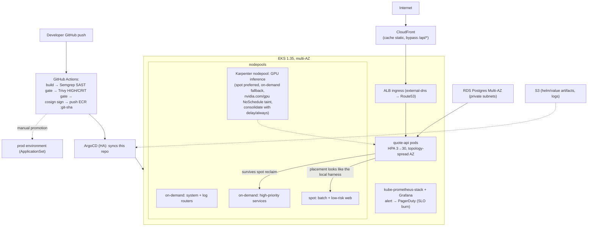

# DevOps take-home: quote-api on k3d with ArgoCD

Local, self-contained harness: a 4-worker-node k3d cluster inside Docker,
GitOps deploy via ArgoCD, spot/on-demand placement, troubleshooting drill,
load testing (k6 + Prometheus/Grafana) and CI (GitHub Actions).

## Quick start

Requires only **Docker** (Docker Desktop / Rancher Desktop / Engine) and
`docker compose`. No kubectl/k3d/helm needed on the host.

```bash
git clone https://github.com/benhuhaudau/devops-takehome.git
cd devops-takehome
docker compose up -d        # builds toolbox img, creates k3d cluster (1 server + 4 agents), applies nodepool labels
./scripts/run-all.sh        # runs every numbered script in order (idempotent)
# Windows cmd/PowerShell: scripts\run-all.cmd
```

Individual tasks:

```bash
./scripts/run-all.sh 10     # parts: 10 = build+load image, 20 = deploy via ArgoCD, 25 = spot reclaim drill, ...
```

After `20-deploy` succeeds:

```bash
curl http://localhost:8080/api/quote    # HTTP API through the ingress
kubectl port-forward -n argocd svc/argocd-server 8082:443   # ArgoCD UI
# open https://localhost:8082 (admin, password: kubectl -n argocd get secret \
#   argocd-initial-admin-secret -o jsonpath='{.data.password}' | base64 -d)
```

## Architecture

```mermaid
flowchart TB
    subgraph host["Host machine (Windows/macOS/Linux)"]
        docker["Docker engine (+ compose)"]
    end
    subgraph cluster["k3d cluster 'takehome': k3s 1.35"]
        server["server-0 control-plane"]
        ag0["agent-0: spot"]:::spot
        ag1["agent-1: spot"]:::spot
        ag2["agent-2: on-demand"]:::od
        ag3["agent-3: GPU, tainted"]:::gpu
        serverlb["k3d serverlb (ports 8080→80, 8443→443)"]
        traefik["Traefik IngressClass"]
        argocd["ArgoCD (argocd ns)"]
        app["quote-api: Helm chart\n(HPA min 3/max 9, PDB minAvailable 2, probes, non-root,\nsolo topology spread acme.io/capacity → 2 on spot + 1 on OD)"]
        ts["troubleshoot ns: web + ai-inference"]
    end
    subgraph toolbox["Toolbox container (bind-mounted scripts)"]
        tools["kubectl, helm, k3d, terraform, k6"]
        scripts["scripts/NN-*.sh"]
    end
    boot["cluster-bootstrap service\n(00-bootstrap.sh: cluster create + troubleshoot/prepare.sh)"]
    ghcr["GHCR: ghcr.io/benhuhaudau<br/>quote-api:git-sha"]

    docker --> boot --> cluster
    docker --> toolbox
    scripts --> tools --> cluster
    ghcr --> app
    argocd --"Application (sync from this git repo)"--> app
    app --> traefik --> serverlb --> "host :8080"
    app:::od
    classDef spot fill:#fee,stroke:#c33;
    classDef od fill:#efe,stroke:#3a3;
    classDef gpu fill:#eee,stroke:#333;
```

**Placement model** (why no hard affinity): 3 replicas, weight-per-capacity:
spot preferred (cost), on-demand presence comes from the topology spread over
`acme.io/capacity` (maxSkew 1 → 2 spot / 1 OD). `ScheduleAnyway` means a spot
reclaim degrades gracefully instead of trapping pods. No GPU node toleration →
the quote API never lands there.

## Script reference

| Script | What it does | When |
|---|---|---|
| `scripts/00-bootstrap.sh` | creates the k3d cluster if missing, waits for Ready, runs provided `troubleshoot/prepare.sh` (labels 2 spot / 1 on-demand / 1 GPU+taint); writes in-cluster usable kubeconfig      | automatic (`compose cluster-bootstrap`) |
| `10-build-push.sh` | builds the quote-api image (multi-stage distroless), imports into the cluster; with `PUSH=1` also pushes `GHCR <git-sha>` + `latest` | after re-building the app |
| `20-deploy.sh` | installs/upgrades ArgoCD via its Helm chart; substitutes the repo URL + image tag into `config/argocd/application.yaml`; ensures deploy + smoke test | Part 2 |
| `25-reclaim-drill.sh` | drains one spot node, curl-loop during reschedule, verifies ≥1 replica lands on on-demand, uncordons | Part 2 proof |
| `30-fix-troubleshoot.sh` | applies `troubleshoot/fixed-app.yaml` and runs provided `verify.sh` until `PASS` | Part 3 |
| `smoke.sh` | in-cluster smoke helper used by deploy/drill scripts | helper |
| `run-all.sh` | runs the above in order | the main entrypoint |

## Design decisions / trade-offs

- **k3d over kind**: k3s ships NetworkPolicy enforcement (kind needs Calico) and multi-node clusters are plain containers: 4 agents with 1 server.
- **Distroless non-root image**: no shell → smaller attack surface, and a `docker top` proof of uid 65532. Tested image: ~7 MB.
- **Soft placement not hard pinning**: hard spot-pinning kills 2/3 replicas' availability on reclaim; hard OD-pinning defeats cost. Node-affinity weights are the tie-breaker; topology spreads set the shape.
- **Image tagging by git short SHA**: the ArgoCD `Application` pins the chart values to `image.tag=<HEAD sha>`, so syncs are reproducible and not "latest".
- **Idempotent everywhere**: `helm upgrade --install`, `kubectl apply`, k3d create-if-missing; run-all safe to re-run mid-way.
- **What we cut**: logging stack (Loki), OPA/Kyverno, external-dns, TLS/certs for the ingress (plain http in this harness), multi-repo GitOps (chart lives in the same repo: ArgoCD multi-source still scopes repo permissions through the App).

## Part 5: Karpenter & Cloudflare (validate-only)

- `infra/karpenter/karpenter-gpu.yaml`: two `karpenter.sh/v1` NodePools (spot weight 80, on-demand weight 20 = fallback) sharing one `karpenter.k8s.aws/v1` EC2NodeClass. GPU taint + 10% disruption budgets with a 6h nightly freeze; `consolidationPolicy: WhenEmpty` so in-flight` inference requests are never consolidated (only empty nodes get removed, after 5m).
- `infra/cloudflare/`: proxied `quote-api` CNAME (5.x resource name `cloudflare_dns_record`), a cache-ruleset (bypass `/api/*`, 7-day edge TTL for static assets) and an `import` block modelling adoption of a hand-created record. Provider ~> 5.
- `scripts/50-validate-tf.sh` runs `terraform fmt -check` + `init -backend=false` + `validate`: passes with no network/credentials beyond provider download.
- **Spot vs on-demand for AI inference**: spot fits stateless, checkpoint-friendly batch and burst inference with retry-on-preempt; it's the wrong default for low-latency interactive paths (chat/completions) where a preemption mid-response is user-visible and a G5 spot replacement costs more than it saves at small scale: there, on-demand with GPU limits/quotas wins. The right pattern (implemented above) is spot-preferred with on-demand fallback per-pool weights and disruption budgets tuned to idle windows.


## Troubleshooting notes (reviewer machine)

1. **Port 8080/8443 already in use**: the k3d loadbalancer publishes them. Change the `8080:80`/`8443:443` mapping in `docker-compose.yml` (`00-bootstrap.sh`) + the `:8080` curl in `25-reclaim-drill.sh`, or free the ports.
2. **Docker Desktop memory**: the cluster + Prometheus stack want ~6 GB. Docker Desktop default (2/4GB) can OOM the bigger pods; raise it to ≥6 GB.
3. **First `run-all.sh` run**: 00-bootstrap waits for nodes; ArgoCD install can take a couple of minutes the first time. Subsequent runs skip straight through.
4. **Linux Docker Engine**: the compose adds `extra_hosts: host.docker.internal:host-gateway`; on old engines (<20.10) remove it or upgrade.
5. **arm64 (Apple Silicon)**: the toolbox image maps `TARGETARCH`, so binaries are arm64; verified on linux/arm64 build paths.

## Reclaim drill: what you should see

`25-reclaim-drill.sh` drains a spot node (cordon+evict), runs a curl loop for
15 s while the PDB keeps `minAvailable: 2` satisfied, waits for the scheduler
to place a replacement on the on-demand node, then uncordons. Expected: failed
proxied requests ≈ 1-3 of 15 with <6 s gaps, and ≥2 ready replicas resumed.

## AI usage disclosure

See [`AI-USAGE.md`](AI-USAGE.md).

## Bonus: production-on-AWS reference design




